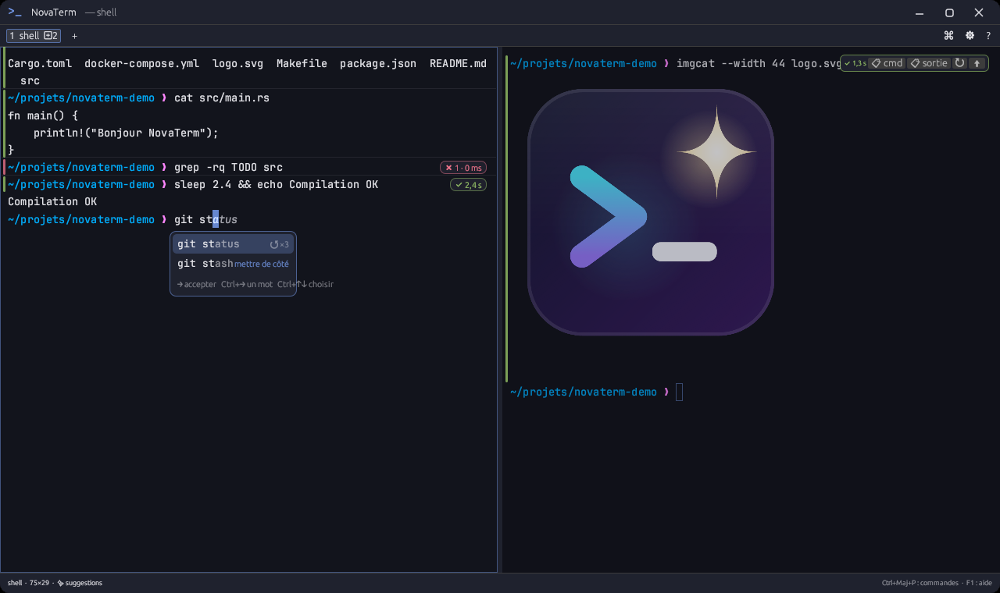
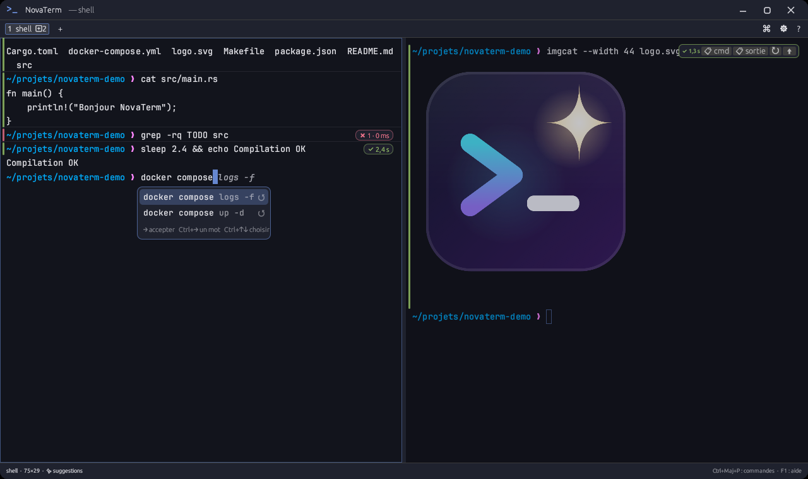
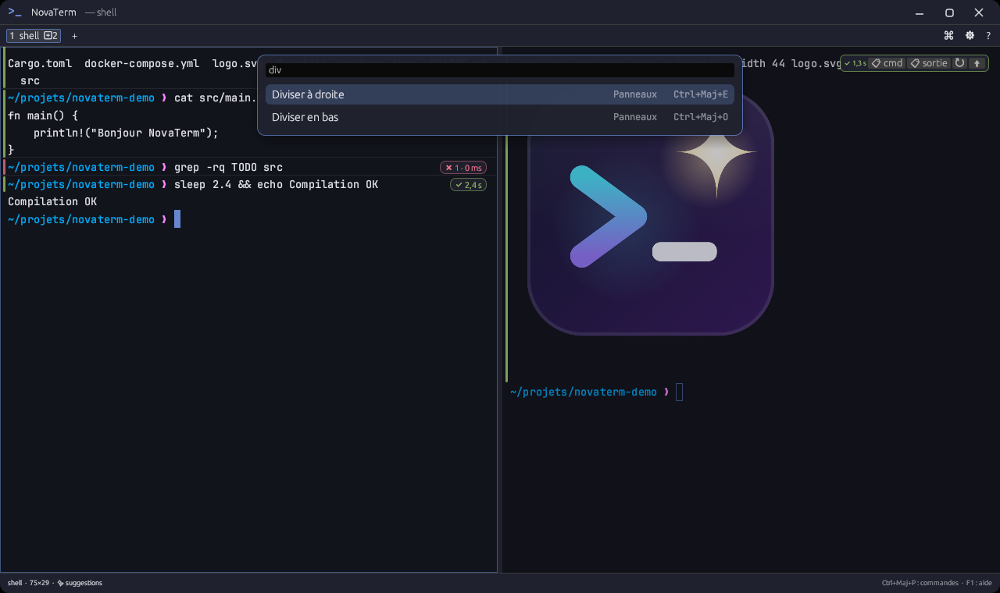
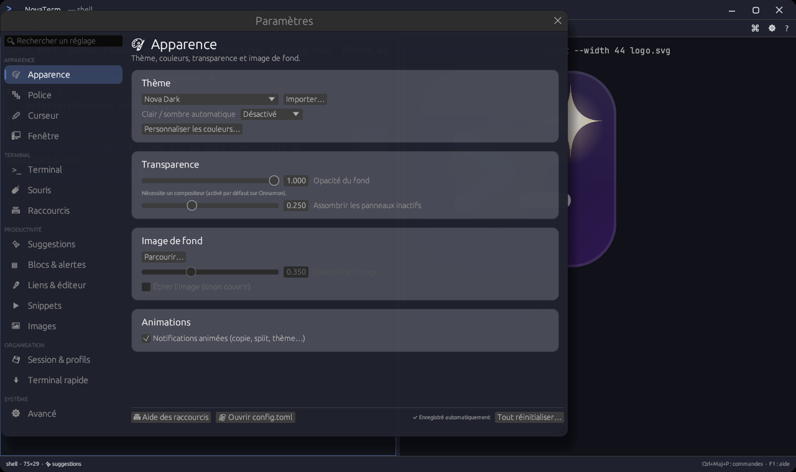

<div align="center">


# NovaTerm

**Le terminal moderne qui vous fait gagner du temps.**
Suggestions de commandes, blocs avec statut, images, liens cliquables, sessions et profils de projet — pour Linux, Windows et macOS.

[](https://github.com/Clarco-Mada-digital/novaterm/releases)
[](https://github.com/Clarco-Mada-digital/novaterm/actions/workflows/release.yml)


[](LICENSE)

[**Télécharger**](https://github.com/Clarco-Mada-digital/novaterm/releases) ·
[Fonctionnalités](#-fonctionnalités) ·
[Installation](#-installation) ·
[Raccourcis](#%EF%B8%8F-raccourcis-essentiels) ·
[Développer](#%EF%B8%8F-développer)

<br>



</div>

> [!NOTE]
> NovaTerm est en **bêta** (versions `0.0.x`). Il est utilisable au quotidien, mais
> des changements peuvent encore arriver. Vos retours sont les bienvenus dans les
> [issues](https://github.com/Clarco-Mada-digital/novaterm/issues).

## ✨ Fonctionnalités

<table>
<tr>
<td width="50%" valign="top">

**✨ Suggestions pendant la frappe**
La suite de la commande s'affiche en gris, d'après votre historique.
<kbd>→</kbd> accepte, <kbd>Ctrl</kbd>+<kbd>→</kbd> accepte un mot.

**🧠 Complétion intelligente**
Sous-commandes et options **avec leur description** : git, docker, cargo, npm,
pip, apt, systemctl, kubectl, Django… plus vos branches git, scripts npm, cibles
make et hôtes SSH.

**▤ Blocs de commandes**
Chaque commande devient un bloc : barre verte / rouge, badge « ✔ 2,4 s » ou
« ✖ 1 », boutons copier la sortie / relancer. <kbd>Ctrl</kbd>+<kbd>↑</kbd> /
<kbd>↓</kbd> pour naviguer de commande en commande.

**🔔 Alertes de fin de tâche**
Un long build se termine pendant que vous êtes ailleurs ? Notification du bureau.

**🖼 Images dans le terminal**
PNG, JPEG, GIF, WebP, **SVG**… `imgcat photo.png`, et les outils compatibles
Kitty / iTerm2 (chafa, viu, ranger, yazi).

</td>
<td width="50%" valign="top">

**🔗 Tout est cliquable**
URL, `src/app.rs:120:5`, traces d'erreur Python / Rust / JS : <kbd>Ctrl</kbd>+clic
ouvre au bon endroit dans votre éditeur (VS Code, Zed, Xed, vim…).

**💾 Sessions et profils de projet**
Vos onglets reviennent au redémarrage. Un profil ouvre d'un coup tout un espace
de travail : serveur, logs, shell, chacun avec sa commande.

**⬇ Terminal rapide**
Une touche (<kbd>F12</kbd>) fait descendre un terminal du haut de l'écran.

**⌘ Palette de commandes**
<kbd>Ctrl</kbd>+<kbd>Maj</kbd>+<kbd>P</kbd> : toutes les actions, vos snippets,
vos profils et les thèmes, en tapant quelques lettres.

**🎨 Personnalisable**
Onglets, splits, thèmes (+ import iTerm2 / Alacritty / Kitty / Windows Terminal),
transparence, polices, curseur animé, raccourcis entièrement modifiables.

</td>
</tr>
</table>

<table>
<tr>
<td align="center"><br><sub>Suggestions depuis l'historique</sub></td>
<td align="center"><br><sub>Palette de commandes</sub></td>
</tr>
<tr>
<td align="center" colspan="2"><br><sub>Paramètres : tout se règle à la souris, avec recherche</sub></td>
</tr>
</table>

## 📦 Installation

Téléchargez le fichier adapté dans la
[**dernière version**](https://github.com/Clarco-Mada-digital/novaterm/releases).

<details open>
<summary><b>🐧 Linux</b></summary>

| Fichier | Pour qui | Installer |
|---|---|---|
| `novaterm_X_amd64.deb` / `_arm64.deb` | Ubuntu, Linux Mint, Debian | `sudo apt install ./novaterm_*.deb` |
| `NovaTerm-X-x86_64.AppImage` | toutes les distributions, sans installation | `chmod +x NovaTerm-*.AppImage` puis double-clic |
| `novaterm-X.rpm` | Fedora, openSUSE | `sudo dnf install ./novaterm-*.rpm` |
| `novaterm-X-linux-x86_64.tar.gz` | sans droits administrateur | décompresser puis `./install.sh` |

**AppImage :** c'est un fichier unique. Au premier lancement, NovaTerm propose de le
ranger dans `~/Applications` et de l'ajouter au menu des applications (avec son
icône). Possible aussi plus tard : Paramètres → Avancé, ou `NovaTerm-*.AppImage --integrate`.
L'AppImage a besoin de FUSE 2 : `sudo apt install libfuse2` si elle ne se lance pas.

</details>

<details>
<summary><b>🪟 Windows</b></summary>

- `NovaTerm-X-setup-x64.exe` : installateur (menu Démarrer, icône du bureau,
  « Ouvrir NovaTerm ici » au clic droit d'un dossier).
- `NovaTerm-X-windows-x64.zip` : version portable, décompresser et lancer `novaterm.exe`.

Shell par défaut : PowerShell 7 s'il est installé, sinon Windows PowerShell ;
cmd, WSL et Git Bash se choisissent dans Paramètres → Terminal.
Application non signée : à la première ouverture, « Informations complémentaires → Exécuter quand même ».

</details>

<details>
<summary><b>🍎 macOS</b></summary>

`NovaTerm-X-macos-universal.dmg` (Intel et Apple Silicon) : glisser NovaTerm dans
Applications. L'application n'est pas encore notariée par Apple : la première fois,
clic droit → **Ouvrir**. Si macOS indique qu'elle est « endommagée » :
`xattr -dr com.apple.quarantine /Applications/NovaTerm.app`

</details>

<details>
<summary><b>🛠 Depuis les sources</b></summary>

```bash
git clone https://github.com/Clarco-Mada-digital/novaterm.git && cd novaterm
./install.sh        # compile et installe dans ~/.local (binaire, icône, menu)
```
Prérequis : voir [Développer](#%EF%B8%8F-développer).

</details>

## 🗑 Désinstallation

| Installé avec | Désinstaller |
|---|---|
| `.deb` | `sudo apt remove novaterm` |
| `.rpm` | `sudo dnf remove novaterm` |
| `install.sh` ou archive `.tar.gz` | `./uninstall.sh` |
| AppImage | `./uninstall.sh` (retire le menu et le fichier rangé dans `~/Applications`), ou supprimer simplement le fichier |
| Windows | Paramètres Windows → Applications → NovaTerm → Désinstaller |
| macOS | glisser NovaTerm d'Applications vers la Corbeille |

`uninstall.sh` détecte aussi les paquets `.deb` / `.rpm` et le raccourci du
terminal rapide, et **demande** s'il faut garder vos réglages (utile pour passer
d'une installation à l'AppImage sans rien perdre) :

```bash
./uninstall.sh            # programme seulement, vos réglages sont proposés à la conservation
./uninstall.sh --keep     # garder réglages, session et profils sans question
./uninstall.sh --purge    # tout effacer, réglages compris
```

L'intégration shell ne modifie jamais `~/.zshrc` ni `~/.bashrc` : rien à y nettoyer.

## ⌨️ Raccourcis essentiels

| Raccourci | Action |
|---|---|
| <kbd>Ctrl</kbd>+<kbd>Maj</kbd>+<kbd>P</kbd> | Palette de commandes |
| <kbd>Ctrl</kbd>+<kbd>,</kbd> | Paramètres |
| <kbd>F1</kbd> | Tous les raccourcis |
| <kbd>Ctrl</kbd>+<kbd>Maj</kbd>+<kbd>T</kbd> / <kbd>Ctrl</kbd>+<kbd>Tab</kbd> | Nouvel onglet / onglet suivant |
| <kbd>Ctrl</kbd>+<kbd>Maj</kbd>+<kbd>E</kbd> / <kbd>O</kbd> | Diviser à droite / en bas |
| <kbd>Alt</kbd>+<kbd>Flèches</kbd> | Changer de panneau |
| <kbd>→</kbd> | Accepter la suggestion |
| <kbd>Ctrl</kbd>+<kbd>↑</kbd> / <kbd>↓</kbd> | Commande précédente / suivante |
| <kbd>Ctrl</kbd>+<kbd>Alt</kbd>+<kbd>H</kbd> | Rechercher dans l'historique |
| <kbd>Ctrl</kbd>+<kbd>Maj</kbd>+<kbd>C</kbd> / <kbd>V</kbd> | Copier / coller |
| <kbd>Ctrl</kbd>+<kbd>C</kbd> | Interrompre le programme (toujours transmis) |

<details>
<summary><b>Tous les raccourcis</b></summary>

Tous sont modifiables dans Paramètres → Raccourcis (« + » puis la combinaison).

| Raccourci | Action |
|---|---|
| Ctrl+Alt+W | Fermer l'onglet |
| Ctrl+Maj+Tab, Ctrl+PagePréc / Ctrl+PageSuiv | Onglet précédent / suivant |
| Alt+1 … Alt+9, Alt+0 | Aller à l'onglet N / dernier (fonctionne en AZERTY) |
| Ctrl+Maj+PagePréc / PageSuiv | Déplacer l'onglet |
| Ctrl+Maj+R, F2 | Renommer l'onglet |
| Ctrl+Maj+W | Fermer le panneau |
| Ctrl+Maj+Flèches | Panneau voisin |
| Ctrl+Maj+J / Ctrl+Maj+H | Panneau suivant / précédent |
| Ctrl+Maj+Alt+Flèches | Redimensionner le panneau |
| Ctrl+Alt+E | Égaliser les panneaux |
| Ctrl+Maj+X | Zoomer le panneau |
| Ctrl+Maj+B | Panneau → nouvel onglet |
| Ctrl+Maj+I | Taper dans tous les panneaux (diffusion) |
| Ctrl+→ | Accepter un mot de la suggestion |
| Ctrl+Alt+C | Copier la sortie de la dernière commande |
| Ctrl+Alt+S / Ctrl+Alt+P | Snippets / profils |
| Ctrl+Insert, Maj+Insert | Copier, coller |
| Ctrl+Maj+S | Coller la sélection (PRIMARY) |
| Ctrl+Maj+A | Tout sélectionner |
| Ctrl+Maj+F (puis Entrée, Maj+Entrée, F3) | Rechercher (regex) |
| Ctrl+Maj+K / Ctrl+Alt+R | Effacer / réinitialiser le terminal |
| Maj+PagePréc / PageSuiv, Ctrl+Maj+Début / Fin | Défiler |
| Ctrl+Maj++ / Ctrl+Maj+- / Ctrl+0, Ctrl+molette | Taille de police |
| Ctrl+Maj+Alt++ / - | Opacité |
| Ctrl+Maj+G | Thème suivant |
| Ctrl+Maj+N | Nouvelle fenêtre |
| F11 / Ctrl+Maj+M | Plein écran / agrandir |
| Ctrl+Maj+F5 | Recharger la configuration |
| Ctrl+Maj+Q | Quitter (confirmation si un programme tourne) |

Souris : double / triple clic = mot / ligne · Alt+glisser = sélection
rectangulaire · clic du milieu = coller · Ctrl+clic = lien · Maj = sélectionner
même dans htop/vim · double-clic sur un séparateur = 50 / 50.

</details>

## ⚙️ Configuration

Tout se règle dans **Paramètres** (<kbd>Ctrl</kbd>+<kbd>,</kbd>), avec une recherche
(« police », « notification »…) ; c'est enregistré automatiquement dans
`~/.config/novaterm/config.toml` (Windows : `%APPDATA%\novaterm`, macOS :
`~/Library/Application Support/novaterm`).

<details>
<summary><b>Intégration shell (suggestions, blocs, notifications)</b></summary>

NovaTerm charge un petit script **en plus** de votre configuration, sans la modifier :

- **zsh** : via `ZDOTDIR` ; `~/.zshrc` est chargé normalement. Tout fonctionne,
  suggestions en direct comprises. Si `zsh-autosuggestions` est installé, NovaTerm le laisse faire.
- **bash** : via `--rcfile` (charge `~/.bashrc`) : blocs, notifications, historique.
  Les suggestions en direct nécessitent zsh.

Scripts générés dans `~/.cache/novaterm/shell-integration/`. Désactivable dans
Paramètres → Suggestions.

</details>

<details>
<summary><b>Ligne de commande</b></summary>

```
novaterm --profile NOM        ouvrir un profil de projet
novaterm --cwd DOSSIER        ouvrir un onglet dans ce dossier
novaterm --quake              terminal rapide ; --toggle l'affiche / le masque
novaterm --imgcat image.svg   afficher une image (--width 40 | 50% | 300px)
novaterm --integrate          AppImage : ranger dans ~/Applications et ajouter au menu
novaterm --unintegrate        AppImage : retirer du menu
novaterm --safe-mode          démarrer avec la police intégrée
novaterm --reset-config       mettre la configuration de côté et repartir à zéro
```

</details>

<details>
<summary><b>Dépannage</b></summary>

- **Bandeau « mode sans échec »** : une police ou un réglage a posé problème au
  lancement précédent. La police intégrée est rétablie ; choisissez-en une autre
  dans Paramètres → Police.
- **Configuration invalide** : elle est mise de côté (`config.toml.invalide`),
  les réglages par défaut sont utilisés, rien n'est perdu.
- Repartir de zéro : `novaterm --reset-config`.

</details>

## 🔒 Sécurité

Un terminal affiche du texte venant de partout (fichiers, serveurs SSH…). NovaTerm
s'en protège par défaut :

- les programmes **ne peuvent pas lire votre presse-papiers** (OSC 52) sans votre accord ;
- un clic sur un lien n'ouvre que `http(s)`, `mailto`, `ftp`, `ssh` — jamais un
  exécutable, un `.desktop` ou une AppImage ;
- le texte collé ne peut pas sortir du mode « collage protégé », et le collage de
  plusieurs lignes peut demander confirmation ;
- images et notifications envoyées par les programmes sont plafonnées (taille,
  mémoire, fréquence) ; les fichiers d'image locaux ne sont lus que s'ils sont
  ordinaires et de taille raisonnable ;
- le terminal rapide n'obéit qu'à un jeton secret lisible par vous seul ;
- l'historique utilisé pour les suggestions reste sur votre machine.

Vous avez trouvé une faille ? Merci de la signaler en privé via
[les avis de sécurité GitHub](https://github.com/Clarco-Mada-digital/novaterm/security/advisories/new).

## 🛠️ Développer

```bash
# Prérequis Linux (Mint / Ubuntu / Debian)
curl --proto '=https' --tlsv1.2 -sSf https://sh.rustup.rs | sh
sudo apt install build-essential cmake pkg-config libx11-dev libxcursor-dev \
  libxrandr-dev libxi-dev libgl1-mesa-dev libxkbcommon-dev libwayland-dev

cargo run                 # lancer en mode debug
cargo test                # tests unitaires
cargo clippy              # lint (doit rester sans avertissement)
cargo check --target x86_64-pc-windows-gnu   # vérifier la compilation Windows
cargo check --target x86_64-apple-darwin     # … et macOS
```

Construire les paquets localement : `./packaging/build-linux.sh all`
(`deb | appimage | tar | rpm`), `packaging/build-windows.ps1` sur Windows,
`./packaging/build-macos.sh` sur un Mac. Résultat dans `dist/`.

Les captures de ce README sont générées par un script :
`NOVATERM_DEMO=packaging/screenshots.demo cargo run` (mode démo interne :
aucune touche n'est envoyée au système).

<details>
<summary><b>Structure du projet</b></summary>

```
src/
  main.rs         lancement, ligne de commande, options de fenêtre
  app.rs          onglets, splits, clavier, souris, palette, blocs, rendu, mode démo
  terminal.rs     PTY + émulation VT, blocs, images, intégration shell
  render.rs       rendu du texte (cache par ligne, cache de glyphes)
  stream.rs       filtre des séquences spéciales (OSC 6973/1337/777/9/7, Kitty)
  blocks.rs       blocs de commandes et marqueurs invisibles
  images.rs       images : iTerm2, Kitty, SVG
  shell.rs        intégration zsh / bash
  history.rs      historique et suggestions
  completions.rs  complétion intelligente
  links.rs        liens, chemins, traces d'erreur, éditeurs
  session.rs      session et profils
  quake.rs        terminal rapide
  appimage.rs     intégration de l'AppImage au menu
  keys.rs         actions et raccourcis
  fonts.rs        polices (validées) ; guard.rs : mode sans échec
  platform.rs     Linux / Windows / macOS
  config.rs, theme.rs, settings.rs, icon.rs, layout.rs, input.rs
packaging/        paquets, script de release, script des captures
docs/images/      captures du README
```

</details>

## 🚀 Versions et publication

NovaTerm suit le [versionnage sémantique](https://semver.org/lang/fr/) :
**MAJEUR.MINEUR.CORRECTIF**, par exemple `1.4.2`.

| Numéro | Quand l'augmenter | Exemple | Commande |
|---|---|---|---|
| **CORRECTIF** (3ᵉ) | corrections de bugs, rien de nouveau | `0.2.3` → `0.2.4` | `./packaging/release.sh patch` |
| **MINEUR** (2ᵉ) | nouvelles fonctionnalités, compatibles | `0.2.4` → `0.3.0` | `./packaging/release.sh minor` |
| **MAJEUR** (1ᵉʳ) | changements incompatibles (réglages, comportement) | `1.9.0` → `2.0.0` | `./packaging/release.sh major` |

Quand un numéro augmente, ceux à sa droite repartent à zéro. Tant que le majeur
vaut `0`, le projet est en développement initial : `0.0.x` = **bêta** (publiée comme
pré-version), `0.x` = stabilisation, `1.0.0` = première version stable. On peut
aussi publier une préversion explicite : `./packaging/release.sh 0.3.0-rc.1`.

**Publier une version** (les paquets ne sont construits que quand vous le décidez,
jamais à chaque push) :

```bash
git add -A && git commit -m "…"            # tout doit être enregistré
./packaging/release.sh minor --dry-run      # simulation, rien n'est modifié
./packaging/release.sh minor                # version, tests, commit, tag, confirmation, envoi
```

GitHub Actions construit alors Linux (x86_64 et ARM64 : `.deb`, `.rpm`,
`.AppImage`, `.tar.gz`), Windows (installateur et `.zip`) et macOS (`.dmg`
universel), puis publie la [Release](https://github.com/Clarco-Mada-digital/novaterm/releases)
avec un `SHA256SUMS.txt`. Construction de test sans Release : onglet **Actions →
Paquets → Run workflow**. Si une construction a échoué après l'envoi du tag, corrigez
puis relancez-la depuis ce même bouton en indiquant le tag (ex. `v0.0.1`) : la
Release est publiée sans toucher au tag (ou `gh workflow run release.yml -f tag=v0.0.1`).

## 🗺 Feuille de route

- [ ] Intégration PowerShell et fish (suggestions et blocs partout)
- [ ] Rendu GPU dédié et ligatures
- [ ] Recherche dans la sortie d'un bloc, repli des longues sorties
- [ ] Synchronisation des réglages et snippets entre machines
- [ ] Extensions / thèmes partagés par la communauté
- [ ] Applications signées (Windows, macOS) et mise à jour automatique

## 📄 Licence

[MIT](LICENSE). La police JetBrains Mono embarquée est sous licence
[SIL Open Font License](assets/fonts/OFL.txt). NovaTerm s'appuie notamment sur
[alacritty_terminal](https://github.com/alacritty/alacritty),
[egui](https://github.com/emilk/egui), [portable-pty](https://github.com/wez/wezterm)
et [resvg](https://github.com/linebender/resvg).
